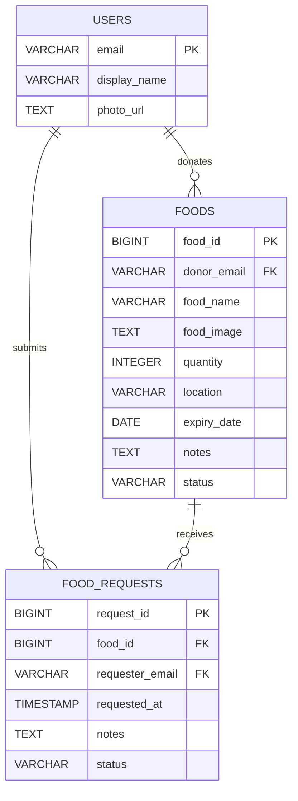

# MealBridge Entity Relationship Diagram

## 1. Overview

The MealBridge database contains three main entities:
- USERS
- FOODS
- FOOD_REQUESTS

## 2. ER Diagram

## 3. Entity Relationships

### USERS and FOODS
One user can donate multiple food items. Each food item belongs to one donor.

### USERS and FOOD_REQUESTS
One user can submit multiple food requests. Each request belongs to one requesting user.

### FOODS and FOOD_REQUESTS
One food item can have multiple request records in the proposed design. Each request refers to one food item.

## 4. Keys

| Table | Key | Column |
|---|---|---|
| USERS | Primary Key | email |
| FOODS | Primary Key | food_id |
| FOODS | Foreign Key | donor_email |
| FOOD_REQUESTS | Primary Key | request_id |
| FOOD_REQUESTS | Foreign Key | food_id |
| FOOD_REQUESTS | Foreign Key | requester_email |

## 5. Conclusion

The proposed ER diagram represents the relational structure of MealBridge. Primary keys uniquely identify records, while foreign keys connect users, food donations and food requests. This design supports referential integrity and organized data management.